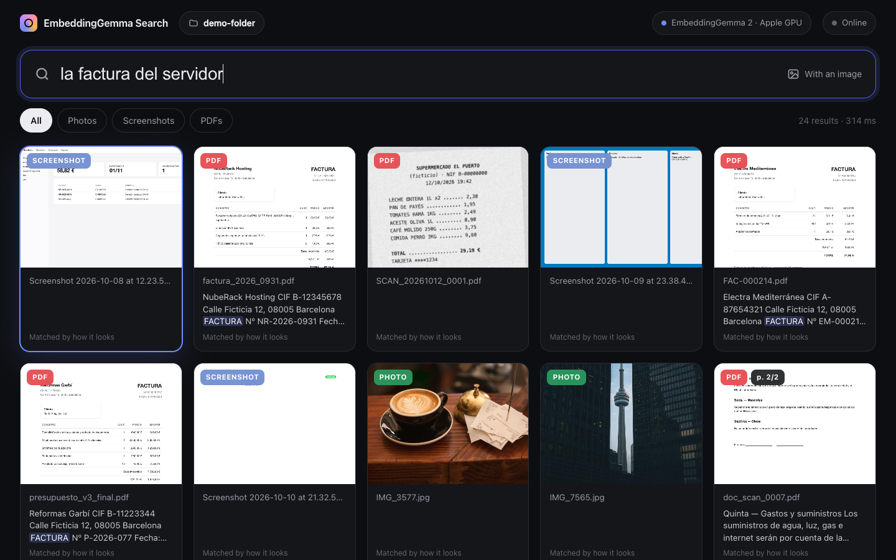
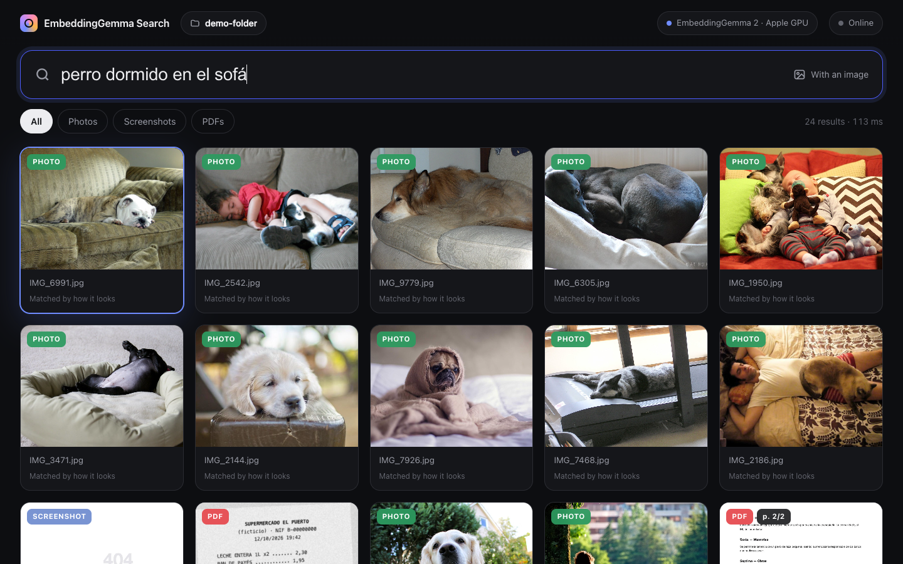
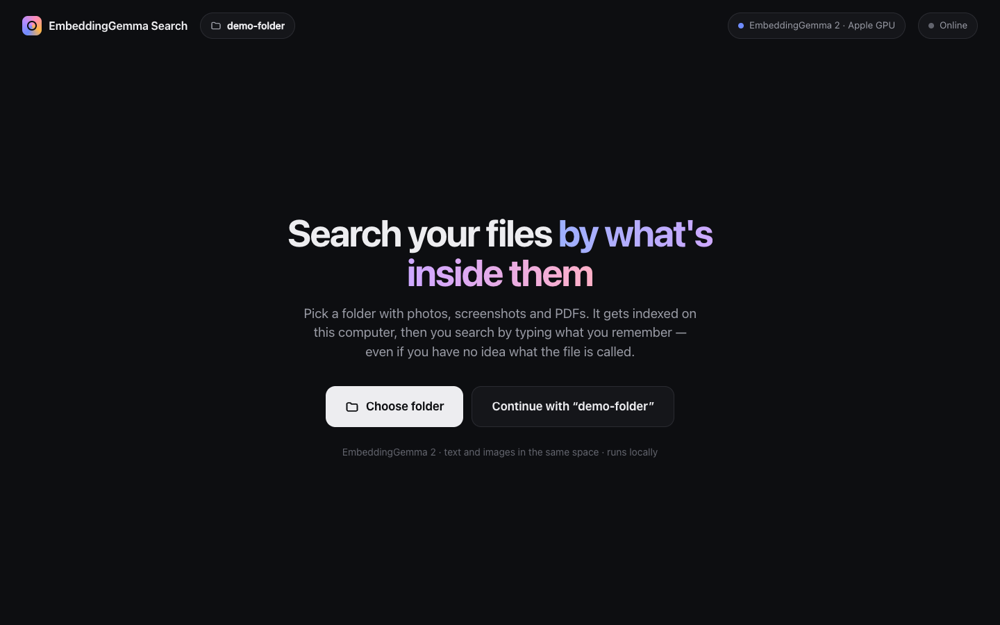
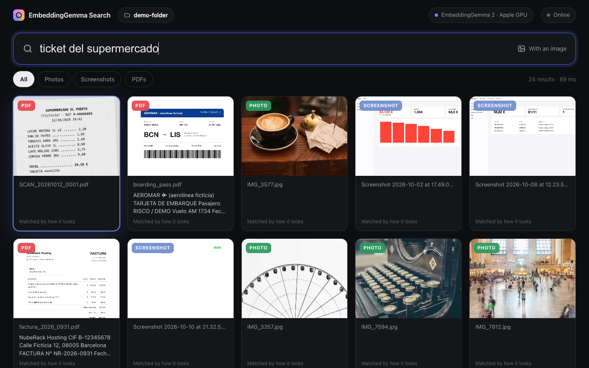
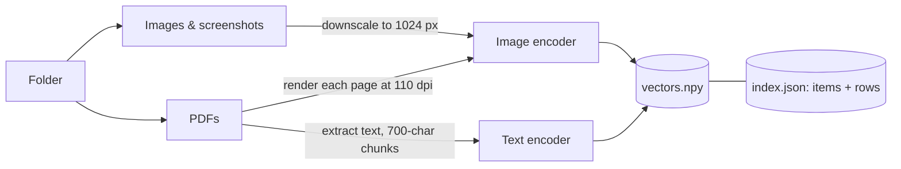

# EmbeddingGemma Search

**Search your photos, screenshots and PDFs by what's *inside* them — locally, offline, with [EmbeddingGemma 2](https://ai.google.dev/gemma/docs/embeddinggemma/model_card_2).**

Pick a folder, index it on your own machine, then type what you remember: *"the server invoice"*, *"dog sleeping on the couch"*, *"supermarket receipt"*. File names don't matter. Text and images are ranked together in a single list, and it works across languages.

The repo ships with a ready-made **demo folder** (303 photos, 15 screenshots, 14 PDFs) so you can try it in five minutes.



---

## Contents

- [What it does](#what-it-does)
- [Quick start](#quick-start)
- [Requirements](#requirements)
- [Installation](#installation)
- [Using the app](#using-the-app)
- [The demo folder](#the-demo-folder)
- [How it works](#how-it-works)
- [Things worth noticing](#things-worth-noticing)
- [Performance](#performance)
- [Privacy and offline use](#privacy-and-offline-use)
- [Index format](#index-format)
- [HTTP API](#http-api)
- [Configuration](#configuration)
- [Limitations](#limitations)
- [Troubleshooting](#troubleshooting)
- [Project structure](#project-structure)
- [Regenerating the demo folder](#regenerating-the-demo-folder)
- [Credits and license](#credits-and-license)

---

## What it does

| You type | What comes back first (measured on the demo folder) |
|---|---|
| `la factura del servidor` (Spanish: *the server invoice*) | A screenshot of a hosting billing panel, then the invoice PDF |
| `the server invoice` | The same two — the query language doesn't matter |
| `perro dormido en el sofá` / `dog sleeping on the couch` | Photos of dogs asleep on sofas |
| `ticket del supermercado` (*supermarket receipt*) | A **scanned** receipt — a PDF with no text layer at all |
| `algo para desayunar` (*something for breakfast*) | That same receipt: it lists milk, bread and coffee |
| `gráfico de ventas que bajan` (*a chart of falling sales*) | The sales report PDF with a falling bar chart, then a dashboard screenshot |
| `a chart going up` | The English growth report with a rising chart |
| `cómo quitar la cal de la cafetera` (*how to descale the coffee machine*) | The coffee machine manual |
| `un error al compilar` (*a build error*) | A terminal screenshot with a failed `npm run build` |

Highlights:

- **Text ↔ image in one space.** A sentence and a photo about the same thing land close together, so one query searches both.
- **Reads what's in the picture.** Screenshots and scanned pages are found by their visual content, with no OCR step.
- **Cross-lingual.** Spanish and English queries return the same results.
- **Local and offline.** Internet is needed once, to download the model. After that you can turn Wi-Fi off.
- **Search with an image.** Drop a photo on the window, or click *Find similar* on any result.



---

## Quick start

```bash
git clone https://github.com/ericrisco/embeddinggemma-buscador.git
cd embeddinggemma-buscador/app
python3 -m venv .venv && source .venv/bin/activate     # Windows: .venv\Scripts\activate
pip install -r requirements.txt
python search.py
```

Then **Choose folder** → pick `demo-folder` → **Index** → wait about 3 minutes → search.

---

## Requirements

| | |
|---|---|
| **OS** | Developed and tested on macOS (Apple Silicon). The code includes the Windows and Linux paths (folder picker, opening files, browser), but they haven't been tested end to end |
| **Python** | 3.11 (tested). 3.12 and 3.13 should work if PyTorch has wheels for your platform |
| **Disk** | ~3 GB: ~1.4 GB for the model and ~1–1.5 GB for PyTorch and the other dependencies |
| **RAM** | ~1 GB peak while indexing the demo folder on a Mac. Plan for 4 GB+ free |
| **GPU** | Optional. Uses Apple Silicon (Metal/MPS) or NVIDIA (CUDA) when available, otherwise the CPU, which is much slower to index |
| **Browser** | Any modern one. With Chrome or Edge it opens as a clean app window |

No Hugging Face account or token is needed: `google/embeddinggemma-2` downloads anonymously.

---

## Installation

### macOS / Linux

```bash
git clone https://github.com/ericrisco/embeddinggemma-buscador.git
cd embeddinggemma-buscador/app
python3 -m venv .venv
source .venv/bin/activate
pip install -r requirements.txt
```

On Linux, the native folder picker needs Tk (`sudo apt install python3-tk` on Debian/Ubuntu). Without it, the app asks you to type the folder path instead.

### Windows

```powershell
git clone https://github.com/ericrisco/embeddinggemma-buscador.git
cd embeddinggemma-buscador\app
py -3.11 -m venv .venv
.venv\Scripts\activate
pip install -r requirements.txt
```

For an NVIDIA GPU, install the CUDA build of PyTorch first (see [pytorch.org](https://pytorch.org/get-started/locally/)), then `pip install -r requirements.txt`.

### What gets installed

| Package | Why |
|---|---|
| `sentence-transformers[image]` | Loads EmbeddingGemma 2 and encodes text and images |
| `transformers`, `torch` | The model runtime |
| `pymupdf` | Reads PDFs: renders each page to an image and extracts its text |
| `pillow`, `pillow-heif` | Image loading, including iPhone HEIC photos |
| `numpy` | Vector storage and similarity |

The web UI is a single HTML file with no build step and no external requests.

---

## Using the app

```bash
python search.py                  # starts the server and opens a window
python search.py --no-window      # server only → http://127.0.0.1:8765
python search.py --port 9000      # another port
```

Or double-click `app/Open search.command` (macOS) or `app/open_search.bat` (Windows) once the virtual environment is set up.

### 1. First run: the model

The first time, the top-right badge shows *Downloading model (first run only)…* while it fetches `google/embeddinggemma-2` (~1.4 GB) into `app/.cache-hf/`. From then on the model loads from disk with the network disabled (`HF_HUB_OFFLINE=1`), and the badge reads *EmbeddingGemma 2 · Apple GPU / NVIDIA GPU / CPU*.



### 2. Pick and index a folder

**Choose folder** opens the system folder picker. The folder is scanned recursively for:

- images: `.jpg .jpeg .png .webp .heic .heif .bmp .gif .tif .tiff`
- PDFs: `.pdf`

Hidden files are skipped. Click **Index** and you'll see a live progress bar, the file being processed, counters (images, PDFs, pages) and the elapsed time. The index is saved, so next time you can click **Continue with "…"** and search right away. Pick the same folder again and click **Index** to rebuild it after adding files.

### 3. Search

| Action | How |
|---|---|
| Search by text | Type in the box and press Enter. Any language |
| Search with an image | **With an image**, or drag and drop a picture anywhere on the window |
| Find similar | Open a result → **Find similar** |
| Filter | **All · Photos · Screenshots · PDFs** (re-runs the current search) |
| Open a result | Click it: images open large; PDFs open **at the matching page** |
| Open the original file | In the viewer: **Open file** or **Show in folder** |
| Show similarity scores | Press `s` |
| Jump to the search box | Press `/` |
| Close the viewer | `Esc` |
| Open a search from a link | `http://127.0.0.1:8765/?q=your+query` (handy for demos) |

Each card shows:

- the type (**PHOTO / SCREENSHOT / PDF + page**);
- the file name;
- for PDFs, the passage of the page most similar to your query, with your words highlighted;
- *Matched by how it looks* or *Matched by its text*, depending on which vector won (see [How it works](#how-it-works)).

The top-right badge turns green, *Offline · everything on this computer*, when there's no connection.

---

## The demo folder

`demo-folder/` is a fake but realistic "Downloads" folder. Every file name is deliberately useless (`IMG_6991.jpg`, `Screenshot 2026-10-08 at 12.23.58.png`, `doc_scan_0007.pdf`) so you can only find things by content.

The documents are in **Spanish** on purpose: the app was built for a Spanish-language video, and searching them in English shows off the cross-lingual matching. One report (`Q3_report_EN.pdf`) is in English.

### Photos — 303

`demo-folder/Photos/`. 45 come from Openverse/Flickr, chosen by topic: dogs on sofas, beaches at sunset, mountain lakes, snowy peaks. The other 258 are random Unsplash photos, the kind of mix you'd find in a camera roll. Author and license of each: [CREDITS.md](CREDITS.md).

### Screenshots — 15

`demo-folder/Screenshots/`, all generated:

| Shows | Try |
|---|---|
| Hosting billing panel (NubeRack, 58.82 €) | `server invoice` |
| Terminal: `npm run build` fails | `build error` |
| Code editor with EmbeddingGemma code | `python code` |
| Chat arranging dinner at a Japanese restaurant | `dinner with friends` |
| YouTube-style analytics, views going up | `views growing` |
| Spreadsheet of a Lisbon trip's expenses | `travel expenses` |
| Online shop: orange running shoes | `sneakers` |
| SaaS pricing table | `pricing plans` |
| Sales dashboard, sales falling | `sales dropping` |
| Kanban board | `to do list` |
| 404 page ("the dog ate it") | `page not found` |
| Flight confirmation email (BCN → LIS) | `flight confirmation` |
| Weekly calendar | `calendar` |
| A social media post ("this is witchcraft") | `someone saying this is witchcraft` |
| Wi-Fi settings | `wifi networks` |

### Documents — 13 PDFs (14 pages)

`demo-folder/Documents/`:

| File | What it is |
|---|---|
| `factura_2026_0931.pdf` | Invoice for a dedicated server (NubeRack Hosting) |
| `FAC-000214.pdf` | Electricity bill |
| `presupuesto_v3_final.pdf` | Quote for a kitchen renovation |
| `doc_scan_0007.pdf` | Two-page apartment rental contract (it allows a small dog) |
| `boarding_pass.pdf` | Boarding pass Barcelona → Lisbon (fictional airline) |
| `reserva_confirmada.pdf` | Hotel booking in Lisbon |
| `Q3_informe.pdf` | Q3 sales report with a falling bar chart |
| `Q3_report_EN.pdf` | Q3 growth report in English with a rising chart |
| `manual_es.pdf` | Espresso machine manual (with descaling instructions) |
| `acta_reunion.pdf` | Team meeting minutes (server migration, photo search prototype) |
| `receta.pdf` | Paella recipe |
| `poliza_2026.pdf` | Car insurance policy |
| `certificado.pdf` | Course certificate |

### Scans — 1 PDF

`demo-folder/Scans/SCAN_20261012_0001.pdf` is a supermarket receipt, photographed slightly tilted and grainy, inside a PDF with **no text layer**. Only the image encoder can find it.



All companies, people, amounts and IDs in the screenshots and PDFs are made up.

---

## How it works

### Embeddings in one paragraph

An embedding model turns a piece of content into a vector, a list of numbers (768 for EmbeddingGemma 2). It's trained so that content with similar meaning gets similar vectors. EmbeddingGemma 2 has a text encoder and an image encoder that write into the **same** vector space, so the vector of *"dog asleep on a couch"* ends up near the vector of a photo of exactly that. Searching becomes geometry: embed the query, find the nearest vectors.

### The model

| | |
|---|---|
| Model | [`google/embeddinggemma-2`](https://ai.google.dev/gemma/docs/embeddinggemma/model_card_2), announced by Google on 6 Oct 2026, open weights, Apache 2.0 |
| Modalities | Text, code, images, video and audio in one shared space |
| Size | 740M parameters in total. This app loads only the text and image encoders, **440M**, by passing `config_kwargs={"audio_config": None}` |
| Output | 768-dimensional vectors, L2-normalised here so a dot product is the cosine similarity |
| Prompts | Queries use `prompt_name="SearchQuery"`, PDF text uses `prompt_name="Document"`, images need no prompt |

### Indexing



- **Photos and screenshots** → resized to at most 1024 px (EXIF orientation applied, HEIC supported) → **1 image vector each**. Files whose name starts with *Screenshot*, *Screen Shot* or *Captura* are labelled as screenshots; everything else is a photo.
- **PDF pages** are indexed **twice**:
  - the page rendered as an image (110 dpi) → **1 image vector**. This is what finds scanned pages, charts and layouts;
  - the page text, split into ~700-character chunks with 120 characters of overlap → **1 text vector per chunk**. Pages with fewer than 25 characters of text get no text vector.
- An **item** is one photo or one PDF page. A **row** is one vector. An item has one image row and zero or more text rows.
- Images are embedded in batches of 8, text in batches of 16, so progress updates in real time.

On the demo folder that's 333 items (303 photos + 15 screenshots + 15 PDF pages) and 348 vectors (333 image rows + 15 text rows).

### Searching

1. The query is embedded with the `SearchQuery` prompt (or, for image search, with the image encoder).
2. It's compared with every row by dot product. This is a brute-force exact search: a few thousand vectors take milliseconds, so there's no vector database.
3. **Mixing modalities.** Text↔text similarities and text↔image similarities fall on different scales. Typical "good" scores are higher for text↔text, the so-called *modality gap*. Sorting raw scores would let one modality bury the other. So, for each query, every row's score is standardised **within its own modality**:

   ```
   z = (similarity − mean of that modality) / std of that modality
   ```

   This asks "how unusually close is this row, compared with the others of its kind?", and those z-scores can be compared across modalities.
4. Each item keeps its **best** row (highest z). That's what *Matched by how it looks* / *Matched by its text* on the card reports.
5. For PDF pages, the **snippet** is always the text chunk most similar to the query, even when the page won through its image. In the browser, the 220-character window with the most query words is shown and highlighted (case- and accent-insensitive).
6. Results are sorted by z and the top 24 are returned. Filters drop other types before the cut.

**Find similar** reuses the item's stored image vector as the query and excludes the item itself. **Search with an image** downscales the uploaded picture the same way as during indexing and embeds it.

### Warm-up

The first pass of a model through the GPU is slow, as kernels get compiled and memory allocated. Right after loading, the app runs a couple of dummy encodes (text, image, document) so your first real search is fast.

---

## Things worth noticing

Real behaviour observed on the demo folder, not cherry-picked marketing:

- **It reads screenshots.** `la factura del servidor` ranks the billing *screenshot* first, and it wins through its **image** vector: the image encoder picks up the text rendered in the picture, with no OCR involved.
- **Scans work.** The receipt PDF has no text layer, yet it's the top result for `ticket del supermercado`, and for `algo para desayunar` (*something for breakfast*) because of the milk, bread and coffee it lists.
- **Same results across languages.** `perro dormido en el sofá` and `dog sleeping on the couch` return the same three photos.
- **Cross-modal surprises.** *Find similar* on a photo of a sleeping dog brings up page 2 of the rental contract, the clause that allows a small dog, next to other dog photos.
- **It also misses.** `tweet`, `post on social media` or `kanban board` don't bring up the right screenshot first: the Wi-Fi settings screenshot (mostly white, with a few short lines) keeps winning. Describing the *content* instead works: `someone saying this is witchcraft` finds the post, `to do list` finds the kanban board. Sparse, text-light screenshots are the weak spot.
- **Most PDF pages win through their image vector** on this folder. It contains far more image rows than text rows, which makes the image z-scores more extreme. The text vectors still contribute the snippet and help on text-heavy queries.

---

## Performance

Measured on a MacBook Pro with **M4 Pro and 24 GB**, Apple GPU (MPS), with the machine otherwise idle:

| | |
|---|---|
| Index the demo folder (333 items → 348 vectors) | **2 min 33 s** (~0.45 s per item) |
| Peak RAM during indexing | **~1 GB** |
| Text search, median of 16 queries | **36 ms** |
| First search after start-up | ~0.3 s |
| Search with an uploaded image | ~0.9 s (encoding the image is the expensive part) |
| Find similar | < 5 ms (the vector is already stored) |
| Model download, first run only | ~1.4 GB |

With other GPU-heavy work running on the same machine (a video render), indexing took about three times longer. On CPU, expect indexing to be much slower. Searching stays fast, because a single query is cheap.

---

## Privacy and offline use

- **Your files never leave your computer.** Thumbnails, vectors and the index are written to `app/indexes/`.
- The server binds to **`127.0.0.1` only**, so other devices on your network can't reach it.
- After the first download, the model loads with `HF_HUB_OFFLINE=1`: Hugging Face is never contacted again.
- The only network call the app makes is for the connection badge: every few seconds it tries to open a socket to `1.1.1.1:53` with a 0.8 s timeout. No data is sent. Remove `online()` from `search.py` if you don't want it.
- The UI loads nothing from the internet: no CDNs, fonts or analytics.

To prove it to yourself: index a folder, turn Wi-Fi off, and keep searching.

---

## Index format

Each indexed folder gets its own directory, `app/indexes/<first 12 hex chars of sha1(folder path)>/`:

```
vectors.npy     float32 array, shape (rows, 768), L2-normalised
index.json      { "folder", "items", "rows", "stats" }
thumbs/         00000.jpg, 00001.jpg … one per item (≤ 1024 px)
```

`index.json`:

```jsonc
{
  "folder": "/path/to/demo-folder",
  "items": [
    { "type": "photo", "path": "...", "rel": "Photos/IMG_6991.jpg",
      "name": "IMG_6991.jpg", "thumb": "00203.jpg", "width": 1024, "height": 768 },
    { "type": "pdf", "path": "...", "rel": "Documents/doc_scan_0007.pdf", "name": "doc_scan_0007.pdf",
      "page": 2, "pages": 2, "thumb": "00325.jpg", "width": 935, "height": 1210, "has_text": true }
  ],
  "rows": [
    { "item": 203, "kind": "image" },
    { "item": 325, "kind": "text", "text": "Quinta — Gastos y suministros…" }
  ],
  "stats": { "date": "…", "photos": 303, "screenshots": 15, "pdfs": 14, "pages": 15,
             "text_chunks": 15, "vectors": 348, "dimensions": 768, "seconds": 152.9,
             "device": "mps:0", "peak_ram_gb": 1.0, "machine": "Apple M4 Pro · 24 GB" }
}
```

`type` is `photo`, `screenshot` or `pdf`; `width`/`height` are the original image size or the rendered page size. Row `i` of `index.json` corresponds to row `i` of `vectors.npy`. `app/indexes/last.txt` remembers the last folder. Delete `app/indexes/` to forget everything.

---

## HTTP API

The UI talks to a small JSON API, which you can use directly:

| Method | Path | Body / query | Returns |
|---|---|---|---|
| GET | `/status` | — | Model status, device, online flag, current index summary, indexing progress |
| POST | `/pick-folder` | — | `{"folder": "..."}` from the native dialog, or `{"manual": true}` if there's none |
| POST | `/index` | `{"folder": "...", "rebuild": true}` | Starts indexing in the background (poll `/status`) |
| GET | `/search` | `q`, `type` (`all`/`photo`/`screenshot`/`pdf`), `n` | `{"ms", "results": [...]}` |
| POST | `/search-image` | raw image bytes, `?type=` | Same as `/search` |
| GET | `/similar` | `id`, `type`, `n` | Same as `/search` |
| GET | `/thumb/<id>` | — | JPEG thumbnail |
| GET | `/file/<id>` | — | The original PDF, or the downscaled image |
| POST | `/open`, `/reveal` | `{"id": n}` | Opens the file / shows it in the file manager |

```bash
curl -s "http://127.0.0.1:8765/search?q=server%20invoice&n=3" | python3 -m json.tool
```

Each result carries the item fields plus `id`, `matched_by` (`image`/`text`), `snippet`, `similarity` (raw cosine) and `z`.

---

## Configuration

Constants at the top of `app/search.py`:

| Constant | Default | Meaning |
|---|---|---|
| `MODEL_ID` | `google/embeddinggemma-2` | Hugging Face model |
| `IMAGE_SIDE` | 1024 | Images are downscaled to this before embedding |
| `PAGE_DPI` | 110 | PDF page render resolution |
| `CHUNK` / `OVERLAP` | 700 / 120 | PDF text chunking, in characters |

Environment: `HF_HOME` (model cache location, default `app/.cache-hf`). Flags: `--port`, `--no-window`.

---

## Limitations

- It's a **demo**, not a product: it doesn't watch the folder. Re-index after adding files.
- Brute-force search keeps every vector in RAM. That's fine for thousands of items; for hundreds of thousands, use an approximate index (FAISS, HNSW).
- Scores are **similarity, not probability**. Ambiguous or nuanced queries can miss, and the model card notes that quality varies across languages.
- Long PDFs take time: every page is rendered and embedded (~0.5 s per page on an M4 Pro).
- The z-score mixing is a simple heuristic. With very few text rows (like the demo folder), image matches tend to dominate.
- Video and audio aren't indexed, although the model supports them.
- One index loaded at a time; switching folders reloads.

---

## Troubleshooting

| Problem | Fix |
|---|---|
| `Address already in use` | Another copy is running. Close it, or use `--port 9000` |
| Badge stuck on *Downloading model* | First run only: ~1.4 GB. Check the terminal for errors and your connection |
| *Could not load the model* | Update the packages: `pip install -U -r requirements.txt`. The terminal shows the full error |
| Indexing is very slow | You're probably on CPU. The badge shows the device. On Macs, check that you're using an arm64 Python, not Rosetta |
| Folder picker doesn't open (Linux) | Install Tk (`python3-tk`). The app falls back to asking for the path |
| HEIC photos are skipped | Make sure `pillow-heif` is installed |
| A PDF opens at the wrong page | Some browser PDF viewers ignore `#page=`. Use **Open file** |

---

## Project structure

```
app/
  search.py              local server: model loading, indexing, ranking, HTTP API
  web/index.html         the whole UI (HTML + CSS + JS, no dependencies, no build)
  requirements.txt
  Open search.command    macOS launcher (double-click)
  open_search.bat        Windows launcher
demo-folder/
  Photos/                303 photos (CC BY / CC BY-SA / CC0 / Unsplash)
  Screenshots/           15 generated screenshots
  Documents/             13 generated PDFs
  Scans/                 1 "scanned" receipt, image-only PDF
tools/
  generate_demo_files.py        builds the screenshots and PDFs (headless Chrome)
  download_openverse_photos.py  topic-based CC photos from Openverse
  download_unsplash_photos.py   random Unsplash photos via Lorem Picsum
  provenance_*.json             author / license / source of every photo
docs/                    screenshots used in this README
CREDITS.md               photo attributions
LICENSE                  MIT (code only)
```

---

## Regenerating the demo folder

You don't need to: it's committed. The scripts are there for transparency and reuse.

```bash
cd app && source .venv/bin/activate && cd ..
python tools/generate_demo_files.py          # screenshots + PDFs (needs Google Chrome; edit CHROME on Windows/Linux)
python tools/download_openverse_photos.py    # CC photos by topic (rate-limited by Openverse: slow)
python tools/download_unsplash_photos.py     # random Unsplash photos
```

The generator uses a fixed random seed, so file names come out identical on every run.

---

## Credits and license

- **Code:** [MIT](LICENSE), © 2026 Eric Risco.
- **Model:** [EmbeddingGemma 2](https://ai.google.dev/gemma/docs/embeddinggemma/model_card_2) by Google, Apache 2.0. Not included in the repo: it downloads from Hugging Face on first run.
- **Photos:** CC BY, CC BY-SA, CC0 and the Unsplash License. Every author and source is in [CREDITS.md](CREDITS.md). The MIT license does not apply to them.
- **Screenshots and PDFs:** generated for this demo. Every company, person and amount is fictional.

Built for a video on the [@ericrisco](https://youtube.com/@ericrisco) YouTube channel (in Spanish), about what EmbeddingGemma 2 makes possible on your own computer.
